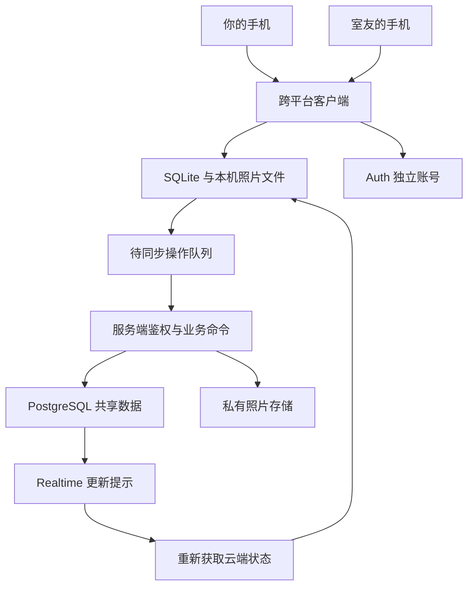

# 双人旅行手账 APP：产品与开发蓝图 v0.1

状态：讨论稿。已确认需求与建议方案分别标注；本文不是已经实现的功能清单。

## 1. 已确认的方向

- 两人共同使用，一人 iPhone、一人安卓。
- 第一版同时包含：旅行手账、共同行程、共同记账、AA。
- 使用云端持久化，让两个人在不同手机上访问同一旅行本。
- 做成可供多次旅行复用的产品，不写死目的地、航班、日期或人物。
- 当前阶段只做需求、产品逻辑、架构与实施路径设计；不初始化业务工程，不开通云服务。

以下有关页面、权限、离线能力、技术选型和交付顺序，均为建议，后续讨论可修改。

## 2. 产品定位与完整闭环

产品定位：两个人一起计划旅程、记录旅途、分清花费、留下回忆的私人旅行本。

核心流程：各自登录 → 一人创建旅行本 → 邀请另一人 → 共排行程 → 写图文手账、记录费用 → 查看 AA → 登记并确认还款 → 导出和归档。

旅行本是共享空间；账号代表个人。两个人各自登录，保留作者、付款人、修改人的身份。

建议每个账号可以参与多次旅行，每个旅行本第一版最多两位成员。不同旅行的数据通过旅行本 ID 隔离。

成功标准：两个不同系统的手机能完成上述全流程；遇到断网、重复提交、照片失败、同时修改时，内容和账目仍可解释、可恢复。

## 3. 第一版功能范围

### 3.1 旅行本与双人共享

- 创建旅行本：名称、封面、目的地文字、可调整的起止日期、默认时区、记账币种。
- 邀请加入：邀请码或链接，单次有效、可过期、未接受前可撤销。
- 邀请被接受后，两人看到同一旅行本；第三位用户无法加入。
- 服务端在同一个事务内验证邀请、成员资格、人数上限，避免同时加入越过人数限制。
- 账号退出登录与退出旅行本是两件事，不共用按钮。
- 建议 v1 先支持固定两人合作，不加入途中换成员的操作；退出、换人及历史数据可见规则需在 PRD 中单独定稿。
- 旅行归档后继续可查看和导出；归档、恢复及编辑权限在详细设计阶段确认。

### 3.2 共同行程

- 按天组织行程条目：标题、日期、可选时间、地点、备注、外部导航链接、排序。
- 状态：计划中、已完成、已取消。
- 两人都可新增、修改、调整排序和删除行程，显示最后修改人。
- 时间暂未决定的事项可只填日期，不为它编造具体时刻。
- 行程可以关联手账和费用；三类内容也可以分别独立创建。
- 删除行程不连带删除已经写下的手账或账目，关联处显示原条目已删除。
- 行程日期与时间不随着手机切换时区自动漂移；跨时区事项可分别保存各地点的当地时间及时区。

### 3.3 旅行手账

- 每条记录包含作者、发生日期、文字、照片、可选地点和行程关联。
- 按旅行日期浏览两人的记录，同一天可以有多条，不强制合成一篇。
- 建议先完成旅行封面、图文组合与每日时间线；纸张风格、贴纸、票根排版通过原型确定。
- 自由拖拽画布、视频和自动生成游记可作为后续增量，不影响 v1 四个核心模块成立。
- 建议默认作者能编辑、删除自己的手账，另一人能查看；双方共同编辑一篇文章属于另一个需要明确的协作模式。
- 未发布草稿建议只保存在作者本机；发布后进入共享旅行本。草稿跨设备同步可另行增加。
- 删去一张照片与删除整条手账分开处理；软删除期间能恢复。

### 3.4 共同记账

- 字段：费用名称、类别、发生日期、记录人、实际付款人、原币金额、原币种、入账汇率、记账币金额、两人分摊、备注及可选票据照片。
- 记录人与付款人分别保存，支持替室友记一笔费用。
- 每笔只有一位付款人；共同付款可拆成两笔记录。
- 分摊支持均摊、仅一人承担、自定义金额，保存前展示两人各自承担多少。
- 两人可以修正共享费用，使用版本校验和修改历史；不允许静默覆盖另一人的修改。
- 误记作废、真实退款、还款转账分别建模。退款关联原费用，不能将退款记为室友还款。

### 3.5 AA 与还款

- 显示旅行总支出、各自垫付、各自承担、当前应收应付和已确认还款。
- AA 只记录债务与还款事实，不在 v1 接入真实支付或自动扣款。
- 还款记录由转出方发起，建议经收款方确认后影响余额；待确认状态单独显示。
- 待确认还款可取消；已确认还款的撤销要保留历史，双方确认规则在 PRD 定稿。
- 结算页面区分云端已同步余额与包含本机待同步费用的预计余额。
- 正式确认还款要求联网，以服务器当前账本版本重新校验，避免对着过期账本确认。
- “当前已结清”是一个账本状态；后来新增或修正费用，可以再次出现应收应付。

## 4. 页面结构建议

旅行本列表位于最外层；进入一本旅行后，建议使用四个主要入口。

1. 旅行概览：旅行封面、成员、今日行程入口、近期记录、同步状态。
2. 行程：按天列表、条目详情、新建及编辑。
3. 手账：每日时间线、手账详情、图文编辑、草稿。
4. 账本：费用列表、新增费用、统计、AA 与还款记录。

补充页面：注册登录、创建旅行、接受邀请、成员与设置、同步问题处理、导出与归档。

AA 放在账本内形成完整闭环，不要求用户在两个独立模块间重复录入。

下一步原型必须覆盖：首次创建、两人加入、普通使用、断网、照片失败、同改冲突、金额输入错误、还款待确认。

## 5. 共享权限建议

- 旅行创建者：管理邀请及旅行设置。不能因为是创建者，就无提示改写另一人的手账。
- 两位成员：读取共享内容，共同编辑行程和费用，创建自己的手账。
- 手账作者：编辑和删除自己的手账；个人草稿不对另一人开放。
- 非成员：不能读取旅行资料、账目、照片或同步事件。
- 修改历史：记录操作者、时间、变更前后版本，不依赖客户端提供的“作者身份”作为授权依据。
- 删除：采用可恢复标记，向另一部手机同步删除状态；保留期限另行确定。
- 删除整个旅行本、注销账号、退出共享空间需要分别定义，不与删除一条内容混用。

成员关系是数据访问的依据。数据库和照片存储都要执行权限校验；只在页面隐藏按钮不能保护数据。Supabase 提供数据库行级权限机制，可按旅行成员关系配置：[官方 RLS 文档](https://supabase.com/docs/guides/database/postgres/row-level-security)。

## 6. 金额、汇率与结算规则建议

### 6.1 金额保存

- 每个旅行本选择一个记账币种，第一笔有效费用产生后不直接切换。
- 原币金额和记账币金额均按对应币种的最小单位存整数，例如人民币分、日元元。
- 汇率使用定点十进制；明确方向，例如“1 日元对应多少人民币元”。
- 换算时统一舍入到记账币最小单位，分摊合计必须严格等于入账金额。
- 均摊遇到尾差，建议由付款人承担多出的最小单位，保存前明确展示。
- 保存每笔使用的汇率快照；后来实时汇率变化，不重算历史账目。
- v1 可先手动输入汇率，不依赖汇率服务才允许记账；自动获取作为后续能力。
- 修改历史金额、币种、汇率、分摊需要生成新版本及修改历史。

### 6.2 账本计算

成员净额 = 有效垫付支出 − 应承担份额 + 已确认转出还款 − 已确认收到还款。

正数表示应收，负数表示应付。退款作为关联原费用的反向流水，同时冲减付款人与承担份额。还款不增加旅行总支出。

服务端维护这些不变量：每笔分摊合计等于费用金额；退款不超过允许退还的剩余金额；两位成员净额合计为零；重复提交不重复记账。

原费用存在有效退款时，修改金额、币种、付款人、汇率或分摊，必须在同一事务内重新校验全部关联退款；不能保持退款一致性的修改应拒绝，并提示先撤销或更正退款。作废原费用也必须同时处理关联退款，不能留下孤立的退款流水。

### 6.3 可用于验收的账目例子

旅行本使用人民币记账，以下为虚构测试数据：

1. A 付 10,000 日元，使用每日元 0.05 人民币的汇率，入账 500 元，两人均摊。
2. B 付 300 元，两人均摊。
3. B 另付 100 元，仅 B 自己承担。
4. 总支出应为 900 元；A 垫付 500、承担 400；B 垫付 400、承担 500。
5. 因此 B 应向 A 还 100 元。
6. B 发起还款 40 元，A 确认后，B 仍应还 60 元；总支出仍为 900 元。

还需验证：奇数分均摊、部分退款、费用作废、改汇率、重复提交、还款待确认与已确认撤销。

## 7. 技术架构建议

主方案：Expo + React Native + TypeScript 跨平台客户端，SQLite 本地保存，Supabase 云端后端。

选择依据：两端共用主要业务代码，保留手机相册和本地存储能力；托管后端减少小团队维护服务的负担。Expo 支持以一个 JavaScript/TypeScript 工程构建 iOS、Android 等平台应用：[Expo 官方文档](https://docs.expo.dev/)。

上图表示两部手机运行同一套客户端代码，各自拥有独立的本地库，不共享一个本地数据库文件。

### 7.1 手机端负责什么

- 页面与交互：导航、表单、手账浏览、行程排序、账目展示。
- 本地数据：SQLite 保存缓存、草稿、待同步操作及版本。
- 照片：选图、压缩、缩略图、持久化本机副本、上传进度与重试。
- 同步：识别网络恢复、应用回到前台、手动重试，展示真实同步状态。
- 登录：安全保存登录凭证，退出或切换账号时隔离本机数据。
- 金额输入与展示：即时反馈，但服务端重新计算并校验最终账目。

Expo SQLite 可以跨应用重启保留本地数据库；云端同步仍由我们实现：[SQLite 官方文档](https://docs.expo.dev/versions/latest/sdk/sqlite/)。

### 7.2 后端负责什么

- Auth：登录与用户身份。
- PostgreSQL：旅行、成员、行程、手账、费用、分摊、还款、版本与修改历史。
- 私有 Storage：照片文件，数据库只存文件路径和元数据。
- RLS 与存储权限：根据成员关系限制读取与操作。
- 数据库事务函数：接受邀请、账目写入、退款、版本比较、幂等处理。
- 必要的 Edge Functions：需要外部调用或文件编排的业务，例如导出任务。
- Realtime：在线更新提示；数据真相仍以持久化数据库为准。

这是有完整业务逻辑的后端。第一版不必另外维护一个只转发数据库读写的 Node 服务。上述模块组合与取舍可参考 [Supabase 官方架构指导](https://supabase.com/docs/guides/getting-started/the-supabase-way-to-build)。

### 7.3 权限与事务边界

- 可直接读取的接口仍执行成员权限；敏感写入统一通过经过授权的业务命令。
- 限制底表直接写入，不能绕过函数只改费用、不改分摊，或伪造已确认还款。
- 每次业务写入在同一事务内完成：身份验证、成员验证、版本比较、业务校验、数据变更、操作去重、修改历史。
- 手机端只使用面向客户端的密钥及用户凭证；管理密钥仅留在服务端。
- 函数若以提升权限方式执行，也必须显式检查调用者，不能假定 RLS 自动保护所有路径。

## 8. 本地保存与共享同步

建议 v1 承诺的离线范围：完成首次联网登录与缓存后，可查看已缓存行程和手账、写文字、暂存照片、记费用。首次登录、接受邀请、确认还款和云端导出需要联网。

已缓存照片可离线看；未缓存照片需要联网加载。系统后台执行不可作为可靠同步前提，优先保证前台及重新打开应用后的补同步。

写入流程：

1. 用户保存，先在本机事务内保存业务内容和待同步操作。
2. 界面显示“已存本机，等待同步”。这时另一人尚不一定能看到。
3. 每个操作生成唯一 ID，带上基础版本，发送给服务端。
4. 服务端在事务内去重、授权、校验并提交，返回正式版本。
5. 收到确认才显示“已同步”。重复发送同一个操作返回相同结果。
6. 另一部手机收到实时提示后重新读取；断线重连和回到前台也主动对账。

v1 数据规模小，建议先做完整的旅行元数据对账与版本检查，照片按需加载；后续再优化增量游标。对账要读取一致快照，不能在分页过程中漏掉变更。修改历史服务于追溯，不直接等同可靠的同步游标。

冲突规则：新增不同记录通常可以合并；同一记录的旧版本更新被拒绝，保留本地修改及云端版本，允许用户比较后再保存；对已删除内容的旧编辑不能自动复活原记录。费用冲突需整笔重新校验金额与分摊。

照片规则：将选中的文件复制到应用的持久化目录，再进入队列；文字与每张照片分别保存状态；上传中断能单张重试，不重复生成整篇手账。云端照片确认完成前，不清理本机待上传副本。

## 9. 核心数据实体草案

以下为逻辑模型，不是已执行的建表语句。

- profiles：账号关联、昵称、头像。
- trips：旅行设置、创建者、记账币种、时区、归档状态。
- trip_members：旅行和用户的成员关系，角色、加入时间。
- trip_invitations：旅行、邀请令牌摘要、过期、撤销、使用状态。
- itinerary_items：行程条目、排序、状态、日期时间、版本、删除标记。
- journal_entries：作者、发生日期、正文、可选行程关联、版本、删除标记。
- media_assets：所属旅行、关联内容、对象路径、类型、上传完成状态、排序。
- expenses：费用、记录人、付款人、原币与入账金额、汇率快照、版本、有效状态。
- expense_splits：费用对应每人的承担金额。
- expense_refunds：原费用、退款金额、汇率口径及两人承担冲减；不混入还款。
- settlements：转出人、收款人、金额、待确认/已确认/已取消/已撤销及确认历史。
- record_revisions：操作人、记录类型、变更前后版本，用于冲突与历史追溯。
- processed_operations：操作唯一 ID、请求身份和处理结果，防止重试造成重复业务记录。
- 本机 drafts / outbox：个人未发布草稿、待同步命令和错误信息，不能被误认作已共享云端数据。

核心关系：一个旅行本有两位成员及多条行程、手账和费用；一笔费用有分摊及可选退款；还款独立于消费。共享业务实体均携带 trip_id，跨表关联必须同属一个旅行本。

## 10. 前后端接口职责草案

以下是待设计的业务命令名称，不代表接口已经存在。

- createTrip / acceptInvite：创建旅行、原子接受邀请。
- readTripSnapshot：按权限获取一致的旅行元数据快照。
- submitOperation：带唯一操作 ID、基础版本和业务载荷提交行程、手账或账目变更。
- reserveMediaUpload / completeMediaUpload：建立有权限的上传目标，校验并确认文件完成。
- getLedger：返回服务端计算的垫付、承担、余额、账本版本。
- proposeSettlement / confirmSettlement：发起和确认还款，同时检查当前版本。
- exportTrip：导出共享内容、账目及有权读取的照片。

错误至少区分：未登录、无权访问、邀请无效、成员已满、版本冲突、金额不平、文件失败、网络失败。界面保留用户已输入内容，再给出可恢复动作。

## 11. 工程组织建议

未来工程结构可以按以下职责划分；当前不创建这些目录或安装依赖。

- apps/mobile：客户端页面、平台能力、本地数据库及同步协调。
- packages/domain：金额、分摊、账本和领域类型；保持可独立测试。
- packages/contracts：客户端与服务端共享的请求、响应和校验约定。
- supabase/migrations：数据库结构、约束、权限和事务函数的版本化变更。
- supabase/functions：需要服务端执行的编排逻辑。
- docs：需求、交互、技术决策、验收用例和发布记录。

业务分摊规则可以共享以提供即时预览，最终有效值由服务端计算。避免在多个页面分别复制 AA 公式。

## 12. 分阶段实施与验收

### 阶段 A：产品定义（当前）

产物：本蓝图、功能边界、权限规则、账目规则、待决策项。

验收：用一个虚拟旅行口述四个模块如何配合，明确什么会共享、什么仍是草稿、谁能改什么。

### 阶段 B：可操作原型

产物：主要页面、完整操作路径、关键异常状态、视觉方向。

验收：你和室友能走完创建、加入、排行程、写手账、记账和 AA，无需先解释技术概念。

### 阶段 C：最小技术验证

产物：分别可安装在两部手机上的测试版本，独立登录、邀请、共享一条文字、上传一张照片、本地暂存与重连。

验收：两台真机读写同一旅行；非成员读取失败；确认网络、照片、iPhone 安装路线确实可用。此阶段先验证难点，不冒充完整 v1。

### 阶段 D：实现四个核心模块

产物：共同行程、图文手账、费用与退款、AA 与还款的完整集成。

验收：完成第 6.3 节账目样例；内容可独立创建和关联；权限与服务端约束一致。

### 阶段 E：同步与数据可靠性

产物：失败重试、同改冲突、删除恢复、账号隔离、同步状态及导出备份。

验收：飞行模式编辑并重启应用后内容还在；重连不丢数据、不重复记账；照片失败能重试；两人同改不静默覆盖；删除不会被旧设备复活；导出可读。

### 阶段 F：双人试用与旅行可用版

产物：你们实际使用数天的问题清单、修复版本、安装说明、必要的备份恢复与发布记录。

验收：日常使用全流程稳定，两部手机的体验都通过；再确定是否提交公开应用商店。

每个阶段完成后有可检查结果，再进入下一阶段。不在安装、账号和离线验证前承诺固定上线日期；四个业务模块全部属于 v1，阶段拆分仅决定交付顺序。

## 13. 测试与发布策略

- 规则测试：金额精度、尾差、汇率冻结、退款上限、净额合计、还款不算支出。
- 后端集成：越权访问、邀请并发、跨旅行关联、幂等重复提交、事务失败回滚。
- 双机验收：独立账号、同步、断网重连、同时修改、照片中断、删除恢复、切换账号。
- 数据留存：导出、数据库备份及照片备份分别验证；数据库备份不等于照片文件已经备份。
- 工程检查：按所用工程执行类型检查、规则与集成测试、两端构建。
- 环境：测试数据与正式旅行数据隔离；数据库变更留迁移记录，发布前验证兼容与恢复方式。

安装是先验证的产品条件：Android 内测可以分发 APK；iOS 可选 Ad Hoc 或 TestFlight。Ad Hoc 需要付费 Apple 开发者账号及测试设备登记，不能照搬 Android 的安装包流程：[Expo 内部分发文档](https://docs.expo.dev/build/internal-distribution/)。TestFlight 的账号、签名和分发条件应在选定路线后核对。

如果你更看重直接打开链接并添加到桌面，也可以讨论 PWA；它有安装和离线能力，但移动端缓存、相册与后台限制需要另做真机验证，不承诺与原生端代码零成本互换：[Expo PWA 文档](https://docs.expo.dev/guides/progressive-web-apps/)。

Supabase 当前列有东京、新加坡等区域；区域只代表主要数据存放位置。选定前实测你们实际网络下的登录、上传、下载、重连，不把区域名称当作跨国访问质量保证：[官方区域列表](https://supabase.com/docs/guides/platform/regions)。

预算包含开发者账号、云数据库、照片容量与下载流量、构建服务；根据实际用量和当前套餐核算，不假定两人使用一定永久免费。此轮不注册、不购买、不部署。

## 14. 我们的团队分工

你：产品负责人。描述真实使用习惯，选择体验和视觉方向，决定取舍与预算；需要时操作本人账号、费用支付和手机安装；与室友做真机验收。

我：产品与工程执行。把讨论写成需求、页面流程、数据模型、接口约定；下一阶段负责前后端实现、同步、测试、问题定位和发布准备，并说明每阶段如何验收。

室友：共同使用者和另一台手机的体验验证人，尤其检查共享内容是否及时、费用是否算得明白。

合作方式：每次讨论保留“已确认 / 建议 / 待决定”；重大变更先更新方案与影响；每阶段提供具体可检查结果。你不需要先学完整套技术才能参与决策。

## 15. 下一轮优先决定的内容

1. 手账体验：更接近照片日记，还是有贴纸、票根、纸张排版的旅行手账；先看少量页面原型再决定。
2. 共享规则：是否接受作者管理手账、双方共改行程和费用；个人草稿是否只留本机。
3. 安装与预算：是否接受 iOS 测试安装和开发者账号成本；若不接受，再调整交付路线。
4. 媒体保存：仅照片还是视频也必须进入 v1；是否要保留照片原画质，这会影响容量和上传体验。
5. 详细账目规则：退款汇率口径、已确认还款撤销、归档后修改、退出旅行及历史内容可见性。

本轮没有把这些待决事项当成用户已经批准的产品要求。
